<div align="center">

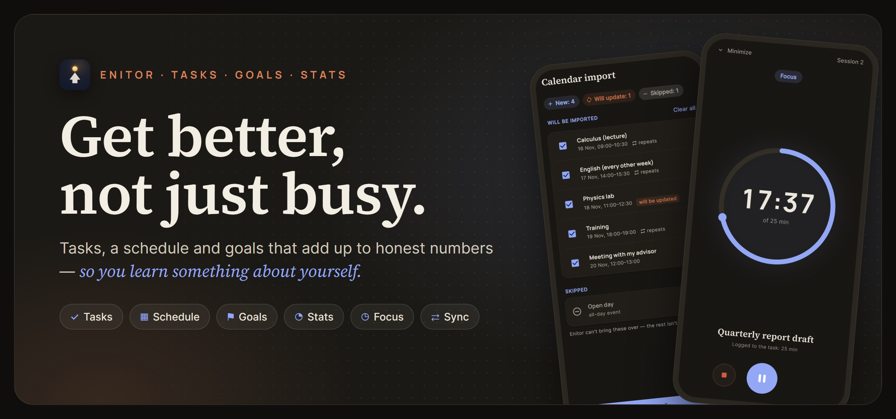

<br/>

**Staying out of your way isn't the goal. Getting better is.**

Tasks, a schedule, goals and honest productivity stats — on Windows and Android, fully local, no account.

[](https://github.com/alexskvo10/Enitor/releases/latest)
[](#-install)
[](#-tech-stack)
[](#)
[](#-your-data-stays-yours)
[](LICENSE)

**[Download](https://github.com/alexskvo10/Enitor/releases/latest)** · **[Website](https://alexskvo10.github.io/Enitor/)** ([по-русски](https://alexskvo10.github.io/Enitor/ru/)) · **[What's new in 0.4.0](#-new-in-040)** · **[Setting it up](#-setting-it-up)**

</div>

---

## ✨ Why Enitor

Most productivity apps aim for one thing: stay out of your way. Log a task, tick it off, forget it. Enitor argues with that. A task list is only worth keeping if it eventually shows you something about yourself — that you're more consistent than you think, that your estimates always run 20% short, that Tuesdays are where you fall off. Enitor is built to surface that, not hide it behind a clean checklist.

Concretely, not as slogans:

- **Estimates that close the loop.** Planned vs. actual time, by task count and by time spent, by task size and by tag — so you find out you're always 20% short, and slowly stop being.
- **Focus time that counts.** Every focus session is logged into the task it was for. Not a stopwatch on the side — more data for the picture above.
- **A week that reviews itself.** On Monday evening Enitor opens the past week for you: productivity against the week before, your best day, the goals you set, whether your estimates got closer. Nothing to fill in.
- **Streaks that are fair, so they're worth keeping.** Empty days neither break nor pad a streak, and today never breaks it while it's still going.
- **A year you can see.** A GitHub-style heatmap turns months of effort into one glance.
- **Achievements for real progress** — volume, consistency, punctuality, milestones — with the top ones hidden as "???" until you earn them.

And the fundamentals that make it worth trusting with your habits:

- **Carry-over is never silent.** At the day boundary Enitor *asks* what to carry over, makes a fresh copy for today, and leaves the original where it was, marked with a small arrow. History is never rewritten, which is what makes the stats honest.
- **The day starts at 4:00, not midnight.** Up late finishing something? Your "today" doesn't flip under you at 00:00 — for the list, for carry-over and for the on-time stat alike.
- **The calendar won't guilt-trip you.** Empty days are neutral, not red; an empty *future* day is blue — "not there yet" isn't "did nothing".
- **Yours.** No account, no Enitor cloud, no telemetry. Sync goes device-to-device or through a server *you* run. Everything else is off until you turn it on.
- **A design system, not a coat of paint.** Warm paper, ink-coloured shadows, one sparing accent, motion that celebrates only what you've actually finished — documented down to the hex code in [`docs/design-overview.md`](docs/design-overview.md).
- **Two real platforms.** Windows and Android from one codebase, the same features and fixes at the same time, fully in English and Russian.

---

## 🆕 New in 0.4.0

| | |
|---|---|
| **⇄ Sync** | Phone and PC directly over Wi-Fi — encrypted, no internet — or through your own `enitor-server`. |
| **▦ Calendars** | Import a `.ics` timetable or link into the Schedule, export it back, move in from Todoist, Google Tasks or TickTick. |
| **▦ Schedule templates** | Save a day of classes or shifts and put it on any other day in one tap. |
| **⚙ Automation** | `enitor://` links and Share, Tasker / Automate, `enitor-cli`, an MCP server for AI assistants, signed webhooks. |
| **▣ Widget** | A Today widget with tick boxes and a quick-add tile on Android. |
| **◷ Focus** | The timer takes the whole screen and keeps it awake; minimize it to a card and back. A chime you won't miss, with vibration. |
| **⚑ Goals** | Counters in hours, filled by focus time; a month's goal can be part of the year's; moving a task keeps its goal. |
| **◔ Rings or bars** | Choose how the day summary looks. |
| **✦ Tour** | A 12-step guided tour on first launch, and a "What's new" card after updates. |

Full notes: [Release 0.4.0](https://github.com/alexskvo10/Enitor/releases/tag/v0.4.0).

---

## 🧭 A look around

<table>
<tr>
  <td width="25%">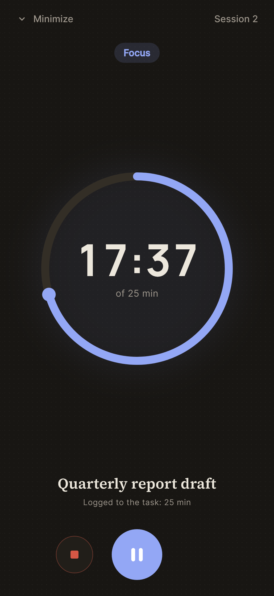</td>
  <td width="25%">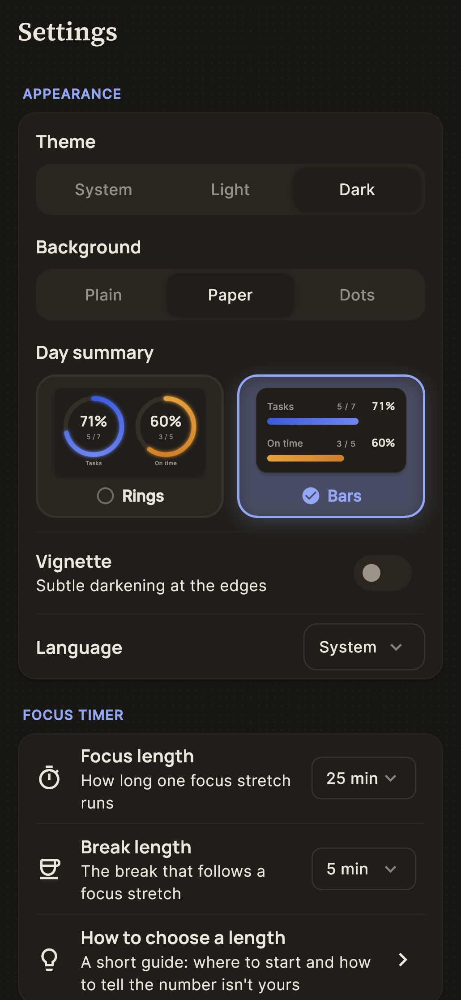</td>
  <td width="25%">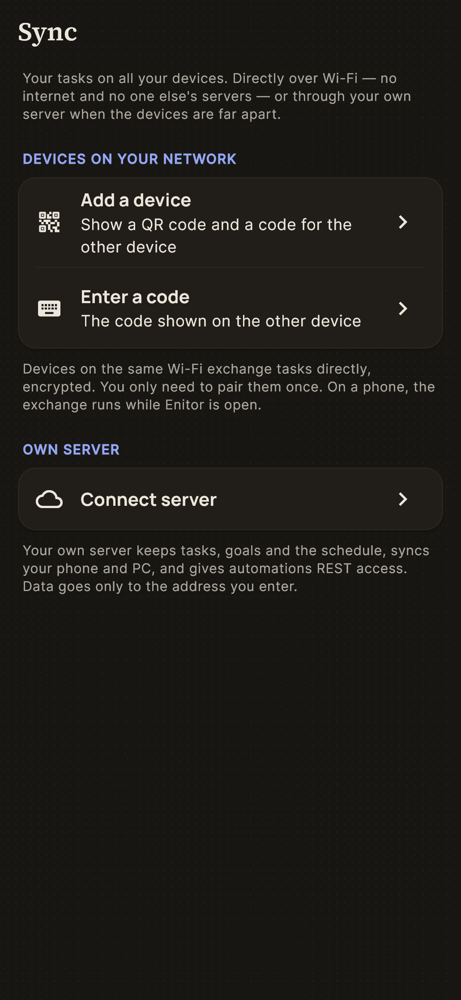</td>
  <td width="25%">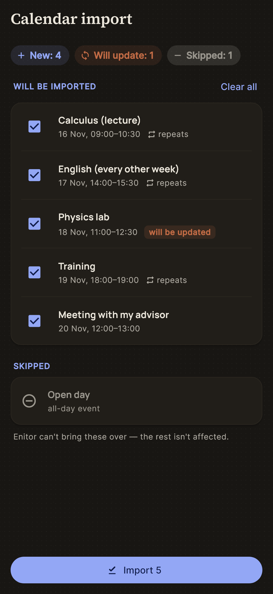</td>
</tr>
<tr>
  <td align="center"><sub><b>Focus</b> — the whole screen, logged to the task</sub></td>
  <td align="center"><sub><b>Day summary</b> — rings or bars, picked from a live preview</sub></td>
  <td align="center"><sub><b>Sync</b> — over Wi-Fi or through your own server</sub></td>
  <td align="center"><sub><b>Import</b> — see what comes in, what doesn't, and why</sub></td>
</tr>
</table>

<details>
<summary><b>More screens</b> — Today, goals, stats, profile, carry-over, weekly review, achievements (Windows, on demo data)</summary>

<br/>

<table>
<tr>
  <td width="33%">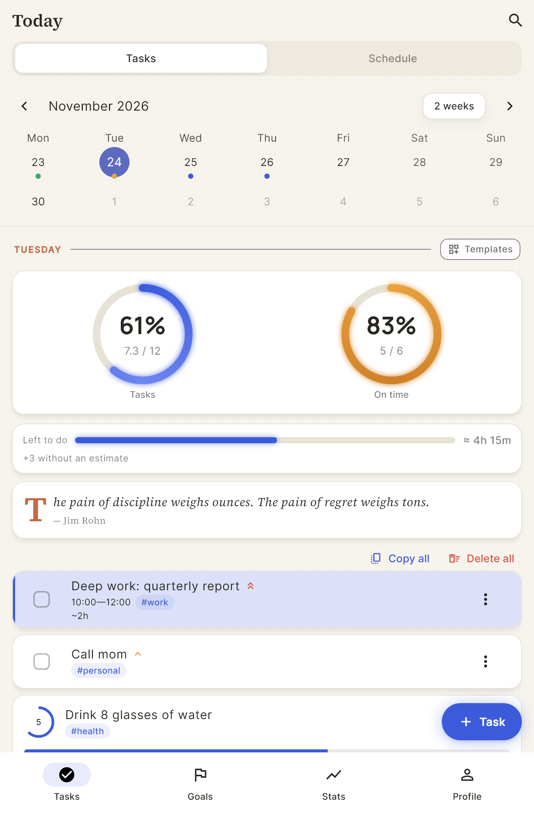<br/><sub>Today — the calendar with a dot per day, the day's rings and the time left for tasks</sub></td>
  <td width="33%">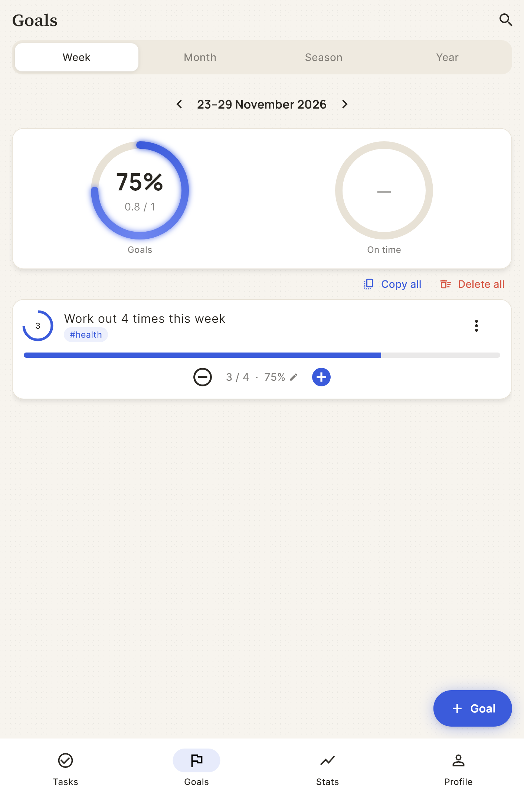<br/><sub>Goals — week, month, season, year, with counters and deadlines</sub></td>
  <td width="33%">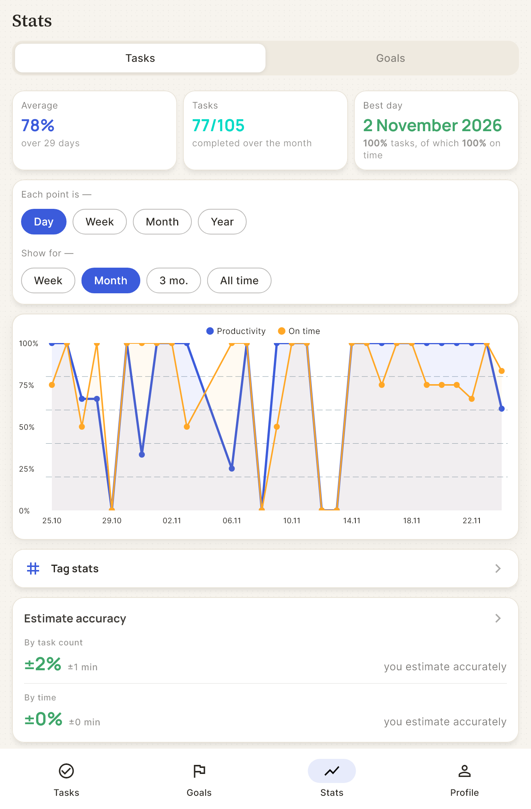<br/><sub>Stats — productivity against on-time, plus estimate accuracy</sub></td>
</tr>
<tr>
  <td width="33%">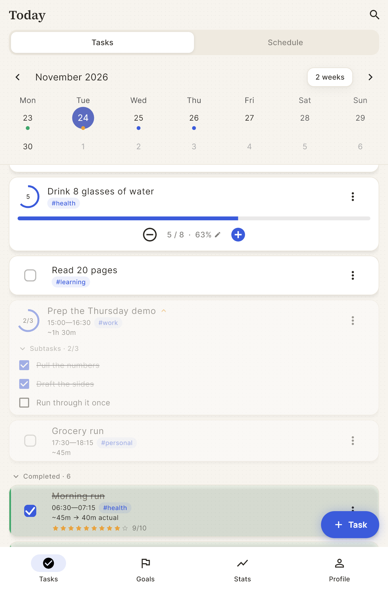<br/><sub>The list — needs attention, unfinished, done with time spent</sub></td>
  <td width="33%">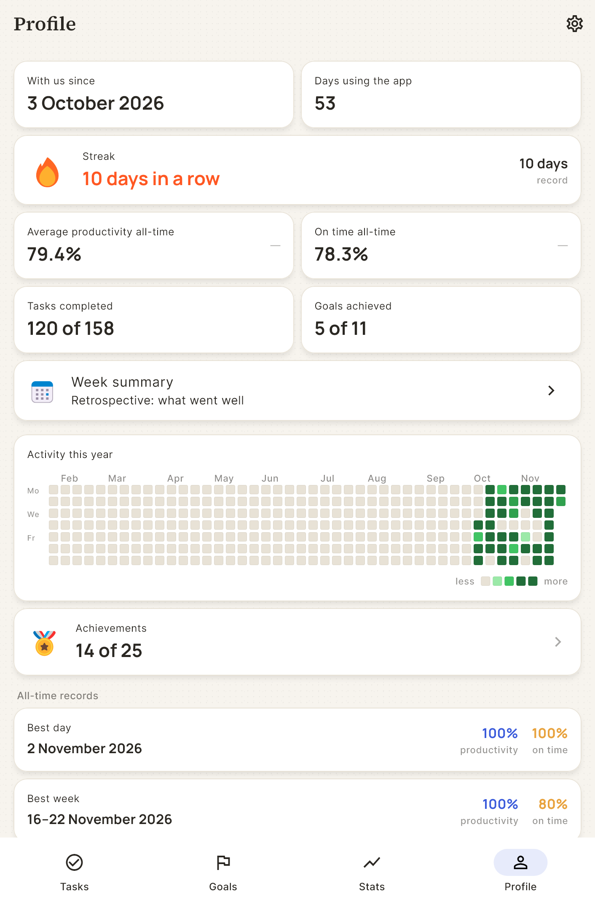<br/><sub>Profile — streak, all-time records, the year heatmap</sub></td>
  <td width="33%">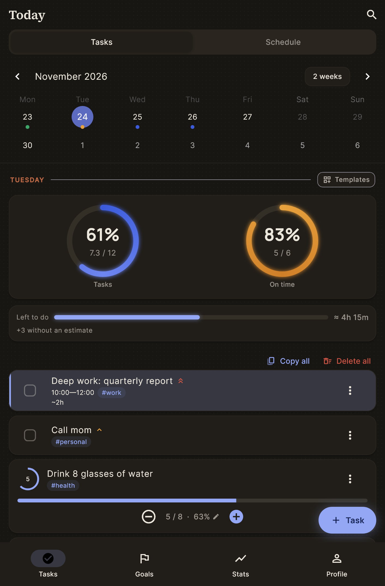<br/><sub>Dark theme — warm charcoal, not blue-grey</sub></td>
</tr>
<tr>
  <td width="33%">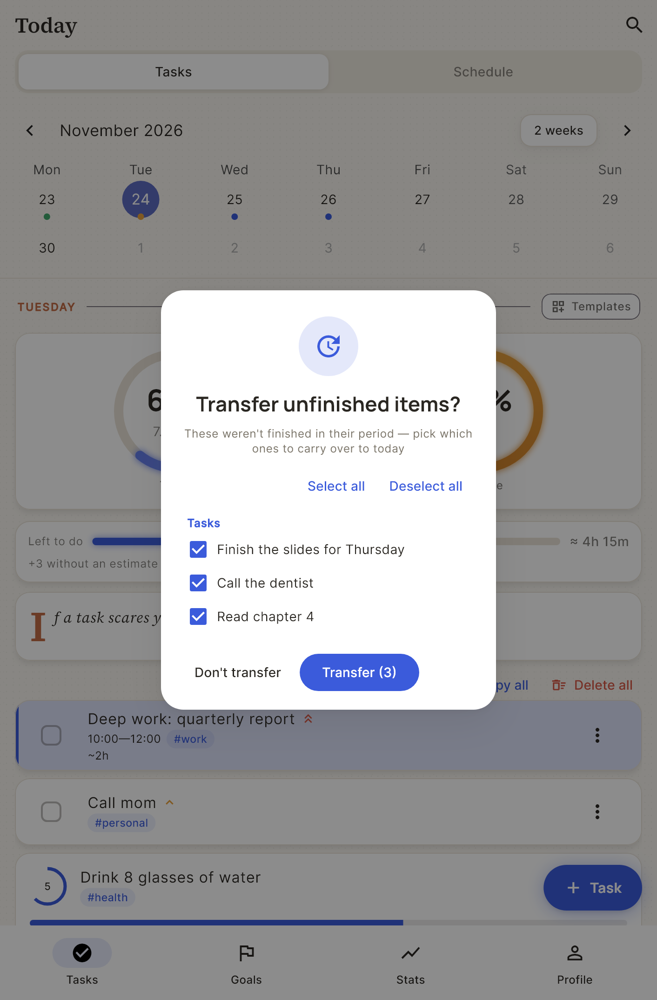<br/><sub>Carry-over at 4:00 — you pick what moves to today</sub></td>
  <td width="33%">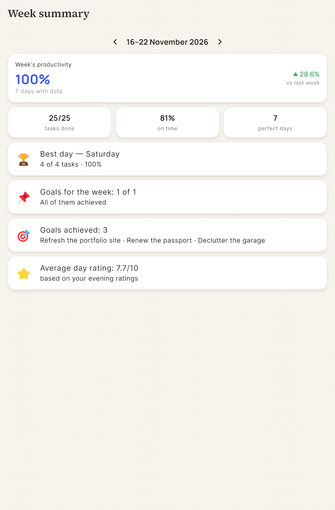<br/><sub>Weekly review — the week against the one before</sub></td>
  <td width="33%">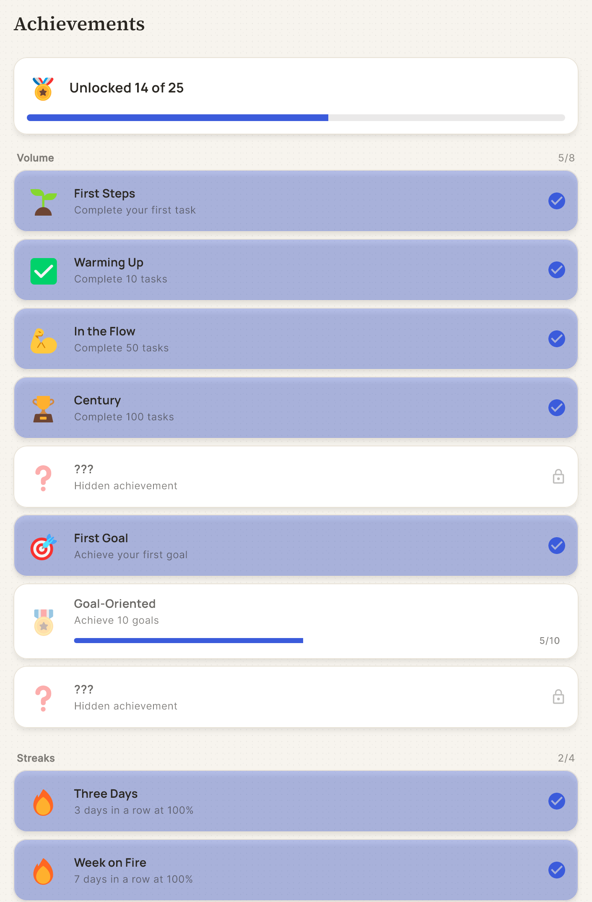<br/><sub>Achievements — some stay hidden until unlocked</sub></td>
</tr>
</table>

</details>

---

## 📦 What's inside

### ✓ Tasks
- Time or time range, description, priority, tags, a checklist, or a counter ("5 glasses of water") — partial progress counts honestly.
- Repeats by weekday, by day of month or every N days.
- **Templates** for days that look alike; *Copy all* to another day; global search through titles, descriptions and tags.
- Overdue and unfinished items go to a **backlog** instead of cluttering today — nothing is dropped silently.
- A line about discipline and small daily progress opens each day, from a curated collection.

### ▦ Schedule
- A tab next to the list for what happens at a time rather than what needs doing: classes, shifts, practice. A start, an optional end, a place, a note, a colour.
- Every week or **every other week** (odd/even timetables), by day of month, or every N days. Move one class "for this day only" and the series stays put.
- Overlaps are marked; the Today card subtracts scheduled time from what's left for tasks.
- A week view, duplicate in one tap, turn an entry — or a whole series — into tasks.
- **Templates** for days that repeat in shape — save a day, apply it to another as one-off entries; whatever is already there isn't doubled.
- **Import from a calendar** (`.ics` file or link) straight from an empty tab.

### ⚑ Goals
- Week, month, season or year, with an optional deadline.
- A checkbox, a counter or a checklist; counters can track linked tasks ("10 workouts this month").
- **Counters in hours** — "20 hours of English this month" fills itself from the focus time of linked tasks (or their estimate, if a task is done without the timer).
- **Goals inside goals** — mark "2 books in November" as part of "24 books this year", and the year fills from the months (and a month from its weeks).
- Moving or copying a task to another day keeps its goal, as long as the goal's period covers the new date.
- `−` on a counter only takes back what you added yourself; progress that comes from tasks goes away when you untick the task.
- Carrying a goal into the next period is a copy, never an edit of the original.

### ◔ Stats & profile
- Productivity and on-time charts by day, week, month or year, for tasks and goals.
- **Estimate accuracy** (median-based, by count and by time, by size and tag), **goal deadline compliance**, per-tag breakdowns — including the average time a task with that tag really takes.
- Streak, year heatmap, **all-time records**, an optional daily rating, and the weekly review that opens itself.
- Achievements for volume, streaks, punctuality and milestones.

### ◷ Focus timer
- Focus, then a break, tied to a task; finished focus time is logged into it and shown on the task card, with or without an estimate.
- **Full screen** with a big countdown ring; the screen stays on. Minimize it to a card and keep going; `Space` and `Esc` on the desktop.
- The end of a stretch is a double chime with vibration in time; music only dips for a moment. Minimized, a *Focus timer* notification plays the same chime.
- Lengths are yours to set (25/5 by default), with a short in-app guide on choosing them.

### 🔔 Notifications
- Start and end reminders, "needs attention", overdue nudges, goal reminders, a morning plan, an evening review, the weekly review, backlog nudges — each on its own switch, with quiet hours.
- **Nothing fires into an empty day**: a nudge you can safely ignore would cheapen all the others.

### ⇄ Sync
- **Over Wi-Fi:** pair once with a QR code or a 12-character code, confirm on your device, and devices on the same network sync by themselves — encrypted, no internet.
- **Through your own server:** `enitor-server` for devices that are far apart; changes arrive in seconds while the app is open, in the background on Android, instantly with a push app such as ntfy.
- Merge or replace on connect, a device list, removing a lost device for good. → [server guide](docs/integrations/server.md)

### ⚙ Integrations & automation
- **Links & Share** — `enitor://` links and *Share → Enitor* open a filled-in form; nothing is added until you press Add.
- **Tasker / Automate** (Android) and **`enitor-cli`** (Windows) — add tasks and schedule entries, tick tasks off, read today's plan if allowed.
- **MCP server** for AI assistants such as Claude Desktop and Cursor.
- **Webhooks** for *task done*, *day closed*, *goal reached*, signed with HMAC-SHA256, retried, with a delivery log.
- **Calendars** — import `.ics` files and links, export your schedule; **move in** from Todoist, Google Tasks or TickTick with a preview of every item.
- **Widget & tile** (Android) — the Today widget with tick boxes and a quick-add tile.

Recipes: [docs/integrations/recipes.md](docs/integrations/recipes.md) · formats: [docs/integrations/formats.md](docs/integrations/formats.md) · по-русски: [рецепты](docs/integrations/recipes.ru.md), [форматы](docs/integrations/formats.ru.md), [сервер](docs/integrations/server.ru.md).

### 🎨 Look & feel
- Light, dark or system theme; plain, paper or dotted background; an optional vignette.
- **Rings or bars** for the day summary.
- A **12-step guided tour**, replayable from Settings; a "What's new" card after updates (can be switched off).
- English and Russian, switched instantly.
- `Ctrl+N` to create, `Enter` / `Esc` / `Tab` in forms.

### 💾 Data & updates
- JSON export and import, a full export for other apps, an automatic backup restored after a clean reinstall.
- Reset settings without touching data, or wipe everything (it offers to export first).
- **Self-update** from GitHub Releases, with the changelog — the system installer on Android, an automatic relaunch on Windows.

---

## 🔒 Your data stays yours

There is **no Enitor server** and no account. Your tasks live on your devices.

Data leaves a device only when you set that up yourself: a webhook address, a calendar link, your own sync server, or a "read" permission for Tasker or an AI assistant. All of it is **off by default**, and Settings → Integrations → Permissions shows it in one place. Sync over Wi-Fi goes only to devices you paired; push notifications from your server carry a wake-up signal, never your data.

---

## 🚀 Install

Grab the latest build from **[Releases](https://github.com/alexskvo10/Enitor/releases/latest)** — no tools needed.

- **Android 7.0+** — download the `.apk`, open it, and allow installs from this source once (Enitor isn't on Google Play).
- **Windows 10+** — download the `.zip`, extract it anywhere, run `enitor.exe`. No installer, no admin rights. `enitor-server.exe` and `enitor-cli.exe` are in the same folder.

After that, Enitor checks for updates itself about once a day and offers to install them.

> [!IMPORTANT]
> **Windows: add `enitor.exe` to your antivirus's trusted list.** Enitor is unsigned, and suites that sandbox unknown apps (Kaspersky and 360 Total Security do) can redirect its registry writes into a shadow copy. Windows then can't find the app's notification registration (`HKCU\Software\Classes\AppUserModelId\Dev.Enitor.App.Desktop`) and **silently drops every notification**. The app can't detect this — reading the value back returns the sandboxed copy — so if reminders never arrive, this is the usual cause.

---

## 🧰 Setting it up

Enitor works the moment it opens: no sign-up, nothing to configure. Everything below is optional — pick what you need. Paths are given as they read in the app (the Russian version mirrors them).

**The first five minutes**

1. **Take the tour.** The first launch offers a 12-step tour of the screens; it's also in Settings → *App tour*.
2. **Allow notifications** when Android asks — and if Today shows *"Reminders might be late"*, tap **Allow** there too, so the system doesn't put Enitor to sleep in the background.
3. **Choose the look:** Settings → *Appearance* — theme, background, **Day summary** (rings or bars), language.
4. **Set the focus timer** to your rhythm: Settings → *Focus timer* (25 / 5 by default).
5. **Pick your reminders:** Settings → *Notifications & connections* → *Notifications* — each kind on its own switch, plus quiet hours.

Then, whatever you need of the following:

<details>
<summary><b>⇄ Sync a phone and a PC over Wi-Fi</b> — no server, no internet</summary>

<br/>

Both devices must be on the same network.

1. On the first device: Settings → *Notifications & connections* → **Sync** → **Add a device**. It shows a QR code and a 12-character code, valid for 5 minutes.
2. On the second device: the same screen → **Enter a code** — type the code, or scan the QR code with the phone's camera.
3. Back on the first device, confirm **Add "…"**.

From then on the devices exchange changes on their own whenever both are on the network, encrypted. The device list shows who's online and when each last synced; **Remove device** cuts off a lost phone, **Leave the group** stops sync on this one.

</details>

<details>
<summary><b>🖥 Sync through your own server</b> — for devices on different networks</summary>

<br/>

1. **Start the server.** On Windows, `enitor-server.exe` is in the Enitor folder:
   ```bash
   enitor-server.exe --data C:\enitor-data --host 0.0.0.0
   ```
   The first start prints a **token** (see it again with `--show-token`). On Linux, build it with `dart build cli -t bin/enitor_server.dart -o build/server`.
2. **Connect each device:** Settings → *Notifications & connections* → **Sync** → *Own server* → **Connect server**. Enter the address (at home, e.g. `http://192.168.1.10:8787`; from outside, an HTTPS address) and the token.
3. The first time, choose **Merge with the data on the server**. *Replace this device's data* starts a device fresh from the server, after an automatic backup.
4. *Optional, Android:* install a UnifiedPush app such as [ntfy](https://ntfy.sh) — changes then arrive within seconds even while Enitor is closed.

Update the server together with the apps: a new kind of data (like schedule templates) is turned down by an older server until it's updated. The same goes for Wi-Fi sync — update every device.

The full guide — HTTPS with Caddy, the REST API for your own automations, what syncs and how conflicts resolve: [docs/integrations/server.md](docs/integrations/server.md) · [по-русски](docs/integrations/server.ru.md).

</details>

<details>
<summary><b>▦ Bring in a timetable from a calendar</b> — <code>.ics</code> file or link</summary>

<br/>

- **From an empty Schedule tab:** press **Take a schedule from a calendar (.ics)**.
- **Any time:** Settings → *Notifications & connections* → **Integrations** → *Calendars* → **Import a calendar file (.ics)** or **Import a calendar by link**.

A preview shows what will be added, what will be updated and what gets skipped — and why (an all-day event has no time slot, for one). Untick anything you don't want. Importing the same calendar again updates its entries instead of duplicating them. A link can refresh itself once a day — off by default.

**Export to a calendar (.ics)** on the same screen saves your schedule and timed tasks for Google Calendar, Outlook or Apple Calendar.

</details>

<details>
<summary><b>📥 Move in from Todoist, Google Tasks or TickTick</b></summary>

<br/>

1. Export from the old app — **Todoist:** in the project, **⋯ → Export as a template (CSV)**; **Google Tasks:** [Google Takeout](https://takeout.google.com) → *Tasks*; **TickTick:** *Settings → Account → Generate backup (CSV)*.
2. In Enitor: Settings → *Data* → **Move in from another app** → pick the file.
3. Check the preview and import.

</details>

<details>
<summary><b>▣ Home-screen widget and quick-add tile</b> (Android)</summary>

<br/>

- **Widget:** long-press the home screen → *Widgets* → **Enitor**. Tick tasks off right there; **New task** opens the form.
- **Tile:** pull down Quick Settings → edit (✎) → drag **New task** into place. It opens a new task from anywhere.

</details>

<details>
<summary><b>🤖 Tasker / Automate</b> (Android)</summary>

<br/>

1. Settings → *Notifications & connections* → **Integrations** → **Tasker and Automate** → *Key* → **Show**, and copy it.
2. In **Permissions** on the Integrations screen, allow Tasker to add. *Read the plan for the day* is a separate switch — leave it off unless Tasker should read your plan.
3. In Tasker, add a **Send Intent** action: action `dev.enitor.app.COMMAND`, package `dev.enitor.app`, target *Broadcast Receiver*, with your key and the command as extras. **Copy the example** gives you a ready one.

Step by step, including reading the plan with a reply: [recipes → Tasker](docs/integrations/recipes.md#1-tasker-android).

</details>

<details>
<summary><b>✨ An AI assistant</b> — Claude Desktop, Cursor and others over MCP (Windows)</summary>

<br/>

1. Settings → *Notifications & connections* → **Integrations** → *AI assistants* → **Copy the settings**.
2. Press <kbd>Win</kbd>+<kbd>R</kbd>, open `%APPDATA%\Claude`, and paste the block into `claude_desktop_config.json` (inside the existing `"mcpServers"` section, if there is one). Quit Claude Desktop fully and start it again.
3. In **Permissions**, allow *AI assistants* to add. *Read the plan for the day* sends task titles to the assistant's model — keep it off unless you're fine with that.

Then just ask: *"add 'call the bank' for tomorrow at 10"*. **Recent calls** shows everything the assistant did. → [recipes → MCP](docs/integrations/recipes.md#2-claude-desktop-on-windows-mcp)

</details>

<details>
<summary><b>⌨ Command line</b> — <code>enitor-cli</code> (Windows)</summary>

<br/>

Settings → *Notifications & connections* → **Integrations** → *Windows* → *Console: enitor-cli* → **Copy the path**, then:

```bash
enitor-cli add Buy milk --date 2026-11-20 --at 18:00 --tag home
enitor-cli today --json
enitor-cli done 3f9a
```

It works from Windows Task Scheduler too — say, a task added every morning. → [recipes → enitor-cli](docs/integrations/recipes.md#6-enitor-cli-on-windows)

</details>

<details>
<summary><b>🪝 Webhooks</b> — n8n, Home Assistant, your own script</summary>

<br/>

1. Settings → *Notifications & connections* → **Integrations** → *Webhooks* → **Add an address**.
2. Paste the URL and pick the events: *A task is done*, *The day is closed*, *A goal is achieved*.
3. Save, copy the **Signing secret** to check the HMAC-SHA256 signature on your side, and press **Test**.

Failed deliveries are retried; the **Delivery log** shows what went where. → [recipes → n8n, Home Assistant and more](docs/integrations/recipes.md#3-n8n)

</details>

<details>
<summary><b>💾 Backups and a new device</b></summary>

<br/>

- Settings → *Data* → **Export to file** saves everything into one file; **Import from file** restores it — on the same device or a new one.
- An automatic backup also brings your data back after a clean reinstall.
- **Full export (JSON)** is for other programs, in a documented format: [formats.md](docs/integrations/formats.md).

</details>

---

## 🎨 Design

Enitor follows one visual language, **"Living Paper"**: warm paper instead of stark white, ink-coloured shadows instead of cold elevation, one sparing accent instead of a rainbow of statuses, a thin stripe and a light tint instead of solid fills, calm human copy on empty and error states. Ordinary transitions fade through the paper without overshoot; the springy moments — a checkbox that *draws itself*, a ring that catches up with a little bounce, an achievement that scatters sparks — are kept for when you've actually finished something.

Every colour, timing and component is specified in [`docs/design-overview.md`](docs/design-overview.md).

---

## 🧱 Tech stack

| Layer | Technology |
|---|---|
| App | Flutter (Dart) |
| State · navigation | Riverpod · go_router |
| Storage | SharedPreferences (JSON), flutter_secure_storage for keys |
| Charts · calendar | fl_chart · table_calendar |
| Notifications | flutter_local_notifications + timezone |
| Sync | TLS over the local network, own server (`bin/enitor_server.dart`), workmanager + UnifiedPush on Android |
| Integrations | `enitor-cli` and MCP over a local pipe, HMAC-signed webhooks, iCalendar import/export |
| Updates | GitHub Releases API + `archive` / `http` |
| Localization | flutter_localizations + intl (en, ru) |

---

## 🛠 Development

Building from source isn't needed to use the app. Details in [docs/setup.md](docs/setup.md).

```bash
flutter pub get
flutter run -d windows          # Windows
flutter run -d <android-device> # Android
flutter test                    # the test suite
```

The Windows release build, with `enitor-server` and `enitor-cli` next to the app: `scripts/build_windows_release.ps1` (needs NASM on `PATH`).

Screenshots for releases and this README are rendered from the real screens on made-up data — no personal task list involved:

```bash
flutter test tool/release_shots/shots_test.dart --update-goldens
```

### Architecture

Feature-first: each feature (`today/`, `goals/`, `stats/`, `focus/`, `integrations/`, …) holds its own screens and providers on top of shared layers — `data/` (models and repositories), `core/` (theme, router, utils), `widgets/`, `services/`. More in [docs/architecture.md](docs/architecture.md).

```
Enitor/
├── lib/
│   ├── main.dart, app.dart
│   ├── core/              # theme, router, utils
│   ├── data/              # models + repositories over local storage
│   ├── features/
│   │   ├── today/         # tasks, calendar, schedule
│   │   ├── goals/  stats/  profile/  retro/  achievements/
│   │   ├── focus/         # full-screen focus timer
│   │   ├── tour/          # guided tour
│   │   ├── backlog/  templates/  search/
│   │   ├── integrations/  # sync, ics, import, webhooks, widget, windows
│   │   └── settings/  help/  about/
│   ├── widgets/  services/
│   └── l10n/              # en + ru
├── bin/                   # enitor_server.dart, enitor_cli.dart
├── android/  windows/
├── assets/                # fonts, icon, quotes, sounds
├── docs/                  # design, architecture, integrations, site
├── test/  tool/
└── pubspec.yaml
```

---

## 📄 License

[MIT](LICENSE) © alexskvo10
